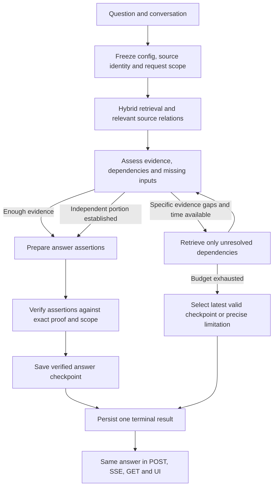

# Second review: make the RAG journey reliable from source to answer

## 1. Assessment and verified findings

**The recurring failures come from several stages disagreeing about the same question, source, or proof. Increasing timeouts alone will not resolve them.**

The system already has useful foundations: hybrid retrieval, reranking, immutable configurations, source governance, structured evidence, claim verification, recovery, and a shared execution runner. The main work is to connect these consistently, correct several deterministic defects, and make verified partial answers survive later failures.

### Evidence examined

- Current checkout: **`5792568`**, unchanged and clean.
- Previous six-question [QA report](E:/python-projects/rag-builder/artifacts/codex-runs/live-browser-qa-20261006-01/report.md), response summaries, and supplied API-response evidence.
- Exact local browser project: **Income Tax & Budget**, project `2ee2756f…`.
- Actual local configuration and source-list GET response bodies captured through browser network observation.
- Current source generation **35**, Project AI configuration revision **45**, and 24 source records.
- Small, offline, in-memory simulations of configuration serialization, translation validation, numeral handling, and passage offsets.

**Evidence boundary:** the earlier live project used source generation 107 and configuration revision 14. The local project is a different configuration/corpus state. The additional defects below are verified code paths or reproduced helper behavior; they are not all proven causes of the earlier production responses. No new chat messages, provider calls, source changes, or implementation changes were made during this review.

### What is failing

| Area | Finding | Practical consequence |
|---|---|---|
| Source relationships | Local withholding amendment SRO273 is marked as replacing the entire SRO210 base and shares its replacement group. | The base document can be excluded completely. If SRO273 is only a partial amendment, retrieval loses unchanged governing rules. |
| Source identity | Original Bangla, authentic English, and consolidated Bangla tax texts have separate histories without sufficient connecting metadata. | Relevance ranking can select an older representation without establishing whether its rule remains current. |
| Amendment governance | Six local `modifies` edges have unknown effects, no scoped provisions, and no supporting spans. Ordinance59 also lacks an effective date. | Repeated retrieval cannot establish facts absent from governance metadata. |
| Metadata editing | An ordinary source correction can discard reviewed amendment-effect and supporting-span fields. | Previously resolved authority can become unresolved after an unrelated edit. |
| Temporal handling | Ranked modifier retrieval drops request scope; historical modifier selection differs from ordinary source selection; downstream authority checks apply another calendar-date test. | The same source can be applicable in retrieval and inapplicable during answer preparation. |
| Evidence text | Passage scores and offsets are calculated on normalized text, then applied to raw text. | The cited/verified span can differ from the span that earned the score. |
| Multilingual handling | Short multiline translations lose subsequent lines; date components are compared without preserving order; Bangla/ASCII numerals have different lexical keys. | Conditions disappear, temporal intent can change, and otherwise relevant evidence is missed. |
| Proof composition | Generic dependencies require the same table boundary. Reviewed additions/amendments lack a suitable compound-proof path. | Valid cross-section or base-plus-amendment evidence is rejected. |
| Verification | Verdicts are matched positionally without strict assertion/proof identity, and canonical request scope is missing from the verifier input. | A statement can be supported by a source while answering the wrong period or scenario. |
| Completion | Proven prerequisites must sometimes appear as separate published claims. Outer timeout handling discards verified answer state. | Useful answers become incorrectly partial, or disappear entirely. |
| Configuration | Preset saves discard execution/recovery overrides submitted by the UI. | Some tuning changes never become effective. Current local Custom configuration avoids this particular defect. |
| Evaluation | Shared runner usage does not reproduce all production history, translation, source-scope, web, and evidence-approach wiring. | Passing evaluation can miss the actual chat failure path. |

### Reproduced deterministic failures

These were small code simulations, not a new end-to-end RAG benchmark:

| Probe | Observed result |
|---|---|
| Passage offsets | A scored normalized span `Exception: does not` selected raw text ending `does no`. |
| Translation | A second line asking whether an extension applies was discarded; validation still passed. |
| Date preservation | `2024-07-01` translated to `2024-01-07` passed literal validation. |
| Numeral matching | `81`/`2026` and `৮১`/`২০২৬` generated different lexical terms. |
| Romanized Bangla | A recognized Banglish query produced no translation target for a Bangla-only corpus. |
| Configuration save | Standard/Quality/Economy/Inherited submissions containing adaptive/recovery settings stored only the profile selection. |

The local configuration currently has **translation disabled**, so translation-parser defects are latent in that configuration. The passage, governance, temporal, and answer-publication defects remain relevant independently.

### Why repeated refinements have not converged

Changes have often improved one stage while another stage retained an incompatible rule:

- Better retrieval cannot recover a base document excluded by replacement metadata.
- More recovery time cannot resolve missing amendment scope automatically.
- Correct retrieved evidence can be rejected by an unrelated table constraint.
- A supported claim can still concern the wrong year.
- A verified partial answer can be lost during optional follow-up work.
- Configuration and evaluation can exercise different behavior from the intended production path.

The required correction is a **single consistent contract across the journey**, followed by targeted performance tuning.

---

## 2. Intended journey and architectural decisions

### Answer journey

### Required behavior

1. **Resolve the question once.** Explicit period, jurisdiction, category, document restriction, user facts, and “known at” cutoff become one immutable scope.
2. **Retrieve applicable evidence.** Publication recency is a ranking signal after applicability and authority—not an instruction to use the newest document.
3. **Assess what is already available before planning more searches.** Complete initial evidence should proceed directly to answering.
4. **Retrieve only identifiable gaps.** Each additional action must name the requirement or dependency it is trying to resolve.
5. **Verify the proposed answer against both source text and request scope.**
6. **Preserve independently verified portions.** Missing personal details, another unresolved topic, or a later timeout must not erase an established rule.
7. **Explain the limitation precisely.** Distinguish missing evidence, unresolved amendment, missing user input, conflicting sources, and unfinished verification.

A partial answer should contain the useful supported result, its citations, the exact unresolved part, and any consequential assumption. It must not attach a generic caveat to an unsupported number.

### Accuracy and latency policy

Keep strict checks for:

- Period and category applicability.
- Numbers, units, negation, exceptions, and amendment effects.
- Citation/proof identity.
- Calculation operands and arithmetic.
- Material contradictions.

Trade time against **breadth and optional corroboration**. Stop searching for secondary details when the central answer is already verified.

For the new bounded policy, use one absolute schedule:

| Policy | Evidence and coverage complete | Draft complete | Verification/finalization complete | Persistence budget ends |
|---|---:|---:|---:|---:|
| Standard | 30 s | 40 s | 58 s | 60 s |
| Extended | 90 s | 100 s | 118 s | 120 s |

These are ceilings from the original request start; stages begin immediately when ready. A search may start only if **search plus its coverage review** fits before the evidence cutoff.

Extended execution must be an explicit project policy. Do not silently extend a normal request because a provider is slow. Preserve existing policy versions for old snapshots; introduce the new behavior through a new configuration revision.

Two seconds for persistence is an operational budget, not a guarantee about network delivery. Measure commit and end-to-end response latency separately.

### What current research supports

- **Structure-aware statutory retrieval:** SearchFireSafety identifies evidence distributed across linked legal instruments and finds benefits from graph-guided retrieval, while also showing risks when statutory context is incomplete. This supports provision-level dependencies and calibrated abstention. [ACL 2026](https://aclanthology.org/2026.acl-long.2112/)
- **Explicit sufficiency and gaps:** S2G-RAG uses structured judgments of sufficient evidence and unresolved gaps to control iterative retrieval. This supports improving the existing recovery controller instead of adding another general agent loop. [ACL 2026](https://aclanthology.org/2026.acl-long.1185/)
- **Multilingual evidence bias:** Recent work finds language preferences in both reranking and citation selection. Bilingual embeddings alone do not establish bilingual answer quality. [All Languages Matter](https://aclanthology.org/2026.acl-long.338/), [Linguistic Nepotism](https://proceedings.mlr.press/v306/ki26a.html)
- **Adaptive work:** Adaptive-RAG supports assigning different retrieval effort to different question complexity. It does not justify allowing retries to consume the time required to finish an answer. [NAACL 2024](https://aclanthology.org/2024.naacl-long.389/)

**My assessment:** RAG is mature enough for useful, cited assistance in this product. Reliable statutory reasoning still requires explicit source identity, temporal applicability, dependency handling, and evaluation. These papers support the architectural direction; none proves accuracy for this Bangla/English corpus or current model configuration.

---

## 3. Detailed implementation plan

### A. Make Project AI configuration truthful and predictable

**Files**

- [project_ai.py](E:/python-projects/rag-builder/backend/app/platform/config/project_ai.py:177)
- [project_ai_config_service.py](E:/python-projects/rag-builder/backend/app/modules/projects/services/project_ai_config_service.py:166)
- [ProjectAISettingsFields.tsx](E:/python-projects/rag-builder/frontend/src/features/projects/ProjectAISettingsFields.tsx:238)
- [conversations.py](E:/python-projects/rag-builder/backend/app/dependencies/conversations.py:387)
- [TestLab.tsx](E:/python-projects/rag-builder/frontend/src/features/lab/TestLab.tsx:510)

**Changes**

1. Separate profile-owned retrieval tuning from independently selected execution/recovery policy.
2. Persist independent overrides for preset and inherited profiles; apply them during effective-config resolution.
3. Always send an explicit profile selection from the UI, including `inherit`. Keep legacy inference in the compatibility reader so an execution-policy-only write does not unexpectedly become Custom.
4. Resolve global execution policy from the configured default rather than the hardcoded `"legacy"` fallback.
5. For the new bounded policy, show actual absolute cutoffs and disable irrelevant legacy focused/broad timeout controls.
6. Display requested configuration, resolved configuration, and conversation snapshot identity. Existing conversations remain pinned; clearly show when they differ from the active project revision.
7. Replace “Choose a certified profile” with the actual certification status. Local profile responses currently identify candidates.
8. Preserve the selected project in the Test Lab → Manage Projects link.

Keep domain instructions for terminology, presentation, and product preferences. Move operational decisions—calendar mapping, execution policy, evidence approach—into typed configuration.

**Acceptance:** save/read round trips preserve each exposed setting; changing a retrieval profile does not silently reset an independently selected execution policy.

---

### B. Establish one temporal and applicability contract

**Files**

- [turn_resolution.py](E:/python-projects/rag-builder/backend/app/modules/conversations/turn_resolution.py:798)
- [turn_resolver.py](E:/python-projects/rag-builder/backend/app/modules/conversations/turn_resolver.py:141)
- [search_service.py](E:/python-projects/rag-builder/backend/app/modules/retrieval/services/search_service.py:299)
- [retrievers/models.py](E:/python-projects/rag-builder/backend/app/modules/retrieval/retrievers/models.py)
- [source_metadata_read.py](E:/python-projects/rag-builder/backend/app/modules/knowledge/source_metadata_read.py:213)
- [current_authority.py](E:/python-projects/rag-builder/backend/app/modules/conversations/current_authority.py:395)
- [grounded_context.py](E:/python-projects/rag-builder/backend/app/modules/conversations/grounded_context.py)

**Changes**

1. Add typed request scope to `RetrievalContext` and forward it to every retrieval route: ordinary, related-source, exact recall, adjacent evidence, and recovery.
2. Make modifier selection consume the same canonical edition/applicability decision as ordinary source retrieval.
3. Carry that decision, scope identity, and provenance into modifier expansion records. Downstream authority handling must consume it rather than recalculate eligibility against today.
4. Keep **legal applicability** and **information available by a date** as separate dimensions.
5. Preserve current-message-attested temporal intent for standalone questions asked after conversation history. Discard only unadopted history-derived semantics.
6. Add optional typed project calendar policy: timezone, period kind, year boundary, and label mapping. Apply it only when user semantics or an explicit project default establishes the required period kind.
7. Record whether a period was explicit or assumed from project policy. An implicit “current” question must not choose its year from whichever retrieved schedule appears newest.
8. If the required period remains materially ambiguous, ask a focused clarification or provide clearly separated conditional results.

A calendar mapping determines the requested period. Source evidence must still establish which rule governs that period.

**Acceptance:** explicit/current/historical questions produce identical scope decisions through initial retrieval, recovery, authority checks, and verification.

---

### C. Repair source relationships and the operator review workflow

**Files**

- [source_metadata_service.py](E:/python-projects/rag-builder/backend/app/modules/knowledge/services/source_metadata_service.py:342)
- [source_metadata.py](E:/python-projects/rag-builder/backend/app/modules/knowledge/schemas/source_metadata.py)
- [sourceUploadMetadata.ts](E:/python-projects/rag-builder/frontend/src/features/sources/sourceUploadMetadata.ts:194)
- [SourceModificationPicker.tsx](E:/python-projects/rag-builder/frontend/src/features/sources/SourceModificationPicker.tsx)
- [source_policy.py](E:/python-projects/rag-builder/backend/app/modules/retrieval/source_policy.py:248)
- [hybrid_retriever.py](E:/python-projects/rag-builder/backend/app/modules/retrieval/retrievers/hybrid_retriever.py:351)
- [source_reconciliation.py](E:/python-projects/rag-builder/backend/app/modules/knowledge/source_reconciliation.py)

**Changes**

1. Preserve complete reviewed relationship payloads during unrelated metadata corrections.
2. Explicitly invalidate review when content identity, target, operation, or affected scope changes.
3. Make whole-document replacement an explicit operator declaration with visible consequences. Add a warning/review gate for uncertain replacement scope; a title containing “amendment” may suggest review but must not automatically change authority.
4. Return relationship discovery as `complete`, `unavailable`, or `truncated`, with affected identities. An exception must not look like “no amendments exist.”
5. For current legal claims, unresolved relationship discovery affects only dependent claims; unrelated proven material remains answerable.
6. Support compound proof for reviewed additions, amendments, and savings clauses: original base passage plus exact modifying passage and conditions. Do not manufacture consolidated statutory text.
7. Replace unconditional one-hop completion with a bounded dependency frontier: initially at most two hops, eight sources, and twenty relationship candidates. These are resource ceilings, not proof that authority is complete.
8. Preserve unresolved frontier identities at the limit. Retrieve specific target provisions rather than rerunning only the broad original query inside each amendment.
9. Wire a small review queue into ingestion for proposed work identity, period facts, and relationships. Proposals remain untrusted until accepted through existing versioned APIs.

**Local corpus correction dossier**

Prepare reviewed corrections for:

- SRO273/SRO210: inspect the actual amendment. If partial, put the amendment in a separate source group and use scoped `MODIFIES`; retain the base.
- Original/English/consolidated tax texts: establish shared work identity where justified, retain representation identity, and record actual legal relationships.
- Six unscoped modifier edges: identify affected provisions, effects, dates, and exact supporting spans.
- Ordinance59: establish the missing effective-date information from the source.
- Historical editions: populate edition identity only when supported by source evidence.

Do not automatically restore previously lost proof from historical revisions. Produce a comparison for review.

---

### D. Make extraction, chunks, and proof spans refer to the same text

**Files**

- [structure_helpers.py](E:/python-projects/rag-builder/backend/app/modules/knowledge/services/chunking/chunk_strategies/structure_helpers.py:343)
- [structural_provenance.py](E:/python-projects/rag-builder/backend/app/modules/knowledge/services/chunking/structural_provenance.py:102)
- [chunking_service.py](E:/python-projects/rag-builder/backend/app/modules/knowledge/services/chunking/chunking_service.py:136)
- [scope_review_service.py](E:/python-projects/rag-builder/backend/app/modules/knowledge/services/scope_review_service.py:104)
- [candidate_content_loader.py](E:/python-projects/rag-builder/backend/app/modules/retrieval/retrievers/candidate_content_loader.py:43)
- [result_hydrator.py](E:/python-projects/rag-builder/backend/app/modules/retrieval/retrievers/result_hydrator.py:70)
- [grounding_service.py](E:/python-projects/rag-builder/backend/app/modules/conversations/grounding_service.py:1682)

**Changes**

1. Score passage windows on immutable raw chunk text. Keep normalized text as a separate lexical/reranker representation.
2. Bind each passage score to source hash, exact span hash, and offsets. Reject or recompute mismatches.
3. Move passage scoring after source-policy filtering and final candidate selection to avoid scoring evidence that will be discarded.
4. Carry parser element identities, row ranges, and source spans through chunk transformations. Stop reconstructing provenance by matching repeated text throughout a document.
5. Consolidate overlapping structural annotation paths into one final derivation plus validation.
6. Let scope review validate noncontiguous chunks using their attested constituent spans. Preserve the contiguous fast path.
7. Keep complete table/header relationships for table evidence; do not crop away a header or exception simply to fit a passage window.

**Migration:** raw passage scoring is a runtime correction. Changed lexical representations or chunk lineage require versioned candidate indexes. Reprocess only affected documents where valid lineage cannot be recovered; do not rewrite active chunks.

**Acceptance:** cited text, scored text, reviewed text, and source offsets agree exactly, including repeated headings and reconstructed tables.

---

### E. Make multilingual retrieval preserve meaning

**Files**

- [text_normalizer.py](E:/python-projects/rag-builder/backend/app/platform/domain/text_normalizer.py)
- [text_tokenization.py](E:/python-projects/rag-builder/backend/app/platform/domain/text_tokenization.py:24)
- [language_detection.py](E:/python-projects/rag-builder/backend/app/platform/domain/language_detection.py:218)
- [llm_query_translation_provider.py](E:/python-projects/rag-builder/backend/app/platform/providers/implementations/llm_query_translation_provider.py:203)
- [semantic_retriever.py](E:/python-projects/rag-builder/backend/app/modules/retrieval/retrievers/semantic_retriever.py:104)
- [hybrid_retriever.py](E:/python-projects/rag-builder/backend/app/modules/retrieval/retrievers/hybrid_retriever.py:615)

**Changes**

1. Add numeral aliases to query and indexed lexical representations while preserving original source text.
2. Version and rebuild the lexical index/statistics; this alone does not require changing embedding space.
3. Use a structured translation response containing one complete translated query. Never remove a line merely because it follows the first line.
4. Preserve typed literals: ordered dates, year ranges, section identifiers, values, and units. Validate target language and retain the original query on translation failure.
5. Route Romanized Bangla according to the applicable corpus languages, including Bangla-only corpora.
6. Retain original multilingual branches. For mixed queries, permit at most one validated rewrite when initial evidence is insufficient.
7. Introduce a bounded semantic-confirmation route for at most two highly relevant, provenance-valid cross-language candidates that fail lexical/original-cosine admission. They still require scope, authority, and claim verification.
8. Keep existing thresholds until paired multilingual positives and hard negatives establish calibration.

A translated dense match or high reranker score must not directly become proof. Conversely, low literal overlap must not permanently prevent semantic confirmation of a correct cross-language passage.

---

### F. Correct proof composition, verification, and partial completion

**Files**

- [execution_contracts.py](E:/python-projects/rag-builder/backend/app/modules/conversations/execution_contracts.py:329)
- [evidence_repair_service.py](E:/python-projects/rag-builder/backend/app/modules/conversations/services/evidence_repair_service.py:611)
- [claim_entailment_service.py](E:/python-projects/rag-builder/backend/app/modules/conversations/services/claim_entailment_service.py:15)
- [grounding_service.py](E:/python-projects/rag-builder/backend/app/modules/conversations/grounding_service.py:1024)
- [message_execution_runner_service.py](E:/python-projects/rag-builder/backend/app/modules/conversations/services/message_execution_runner_service.py:1695)
- [publication_integrity.py](E:/python-projects/rag-builder/backend/app/platform/domain/publication_integrity.py:26)

**Changes**

1. Type dependency purpose:
   - Structural table/header continuation.
   - Definition or applicability.
   - Amendment or exception.
   - Calculation operand.
2. Apply same-table constraints only to structural dependencies. Legal dependencies may cross sections/documents when their relation, scope, and provenance are validated.
3. Separate proof prerequisites from requested answer deliverables. A prerequisite can be satisfied through the published claim’s proof closure without appearing as another paragraph.
4. Version the verifier protocol. Every verdict must return assertion ID, approved proof identities/hashes, and assessment against canonical scope. Reject missing, duplicate, unexpected, or foreign bindings. Decode legacy verdicts only for historical diagnostics.
5. Preserve independently valid rule evidence before optional personal-input classification. A rule lookup should not require all facts needed for personal eligibility.
6. Require explicit per-claim dependencies for numeric answers. An unrelated unresolved numeric topic must not block an independent result.
7. Bind arithmetic operands to role, unit, period, category, and source/user origin. Isolate local calculation failures to their connected component; foreign proof references remain fatal.
8. Check exact approved-span identity before requesting similarity embeddings. Batch necessary span-location work; remove embeddings that add no decision value before semantic verification.
9. Use structural completeness where available. Unpunctuated statutory text must not be rejected solely because sentence punctuation is absent.
10. Isolate domain-specific semantic guards as versioned validators with explicit outcomes and paired positive/negative cases.

**Initial evidence assessment**

Refactor existing planning/coverage code into one initial assessment that returns:

- Requirements and dependency types.
- Validated evidence bindings.
- Missing source evidence.
- Missing user inputs.
- An answer draft for independently supported requirements, when available.

Complete initial evidence goes directly to verification. Recovery works only on remaining gaps. Keep the current runner as the orchestrator.

---

### G. Make deadlines finish answers and preserve verified work

**Files**

- [request_work.py](E:/python-projects/rag-builder/backend/app/platform/providers/request_work.py:148)
- [recovery_schedule.py](E:/python-projects/rag-builder/backend/app/modules/conversations/services/recovery_schedule.py)
- [message_execution_runner_service.py](E:/python-projects/rag-builder/backend/app/modules/conversations/services/message_execution_runner_service.py:1489)
- [evidence_repair_service.py](E:/python-projects/rag-builder/backend/app/modules/conversations/services/evidence_repair_service.py:2366)
- [chat_service.py](E:/python-projects/rag-builder/backend/app/modules/conversations/services/chat_service.py:259)
- [terminal_outcome.py](E:/python-projects/rag-builder/backend/app/modules/conversations/terminal_outcome.py)

**Changes**

1. Add versioned `bounded_v2` and `bounded_extended_v2` policies using the schedules above. Both use one implementation; preserve existing legacy/adaptive snapshot semantics.
2. Remove competing whole-recovery duration wrappers for the new policies. Retain provider timeouts bounded by the remaining absolute phase time.
3. Use frozen measured latency estimates for action admission and output sizing. Estimates must not extend the deadline.
4. Add an immutable **verified answer checkpoint** containing final text, assertion/proof bindings, citations, scope, fulfilled requirements, and limitations.
5. Update the checkpoint only after successful verification/finalization.
6. Route ordinary completion, timeout, failed repair, and exhausted recovery through one terminal reducer.
7. At timeout, select the latest valid checkpoint. Evidence-only state and unverified drafts remain ineligible for publication.
8. Check shape-repair eligibility before making a model call. An unparsable original with no recoverable immutable assertion inventory must not trigger a repair call that is guaranteed to be rejected.
9. Configure regular POST, SSE, and evaluation from the same schedule. Keep final content consistent with persisted content.

The earlier 24-second timeout does not imply that another 36 seconds was freely available: downstream reserves and absolute phase limits already consumed that budget. The new policy makes those constraints explicit.

---

### H. Remove avoidable work and repair evaluation fidelity

**Files**

- [conversations.py](E:/python-projects/rag-builder/backend/app/dependencies/conversations.py:453)
- [evaluation.py](E:/python-projects/rag-builder/backend/app/composition/evaluation.py:346)
- [evaluation/ports.py](E:/python-projects/rag-builder/backend/app/modules/evaluation/ports.py:73)
- [chat_service.py](E:/python-projects/rag-builder/backend/app/modules/conversations/services/chat_service.py:1263)
- [keyword_retriever.py](E:/python-projects/rag-builder/backend/app/modules/retrieval/retrievers/keyword_retriever.py)
- [web_evidence_review.py](E:/python-projects/rag-builder/backend/app/modules/conversations/services/web_evidence_review.py)

**Changes**

1. Share production/evaluation retrieval composition, including recovery translation, concurrency, source/build scope, and provider accounting.
2. Add optional history, prior citations/metadata, and source restrictions to evaluation case input.
3. Pass effective evidence approach, translation policy, and web configuration into evaluation.
4. Skip fallback keyword-stat queries when SQL already supplied all required BM25 scores.
5. Measure the existing persistent embedding cache before adding another cache. Preserve identity isolation and compare cold/warm behavior.
6. Avoid project-wide diagnostic expiration inside answer persistence; use the existing retention process.
7. Resolve immutable build/config/scope fingerprints once rather than repeatedly collecting project-wide review data.
8. Report provider usage by purpose—resolution, translation, assessment, generation, verification, recovery—and measure through completed persistence.
9. Make web fallback requirement-specific. Respect indexed-only/document restrictions; unresolved authority must not be bypassed with an unreviewed web snippet. An allowed independent official source must pass the same applicability and proof checks.

Do not introduce a graph database, another orchestration framework, blanket larger context windows, or a model migration in this repair. Reconsider them only after the corrected path is measured.

---

## 4. Validation and rollout

### Phase 1 — Stop deterministic corruption and establish trustworthy evaluation

Implement configuration round trips, request-scope propagation, raw-span binding, metadata-proof preservation, translation parsing, verifier identity, and production/evaluation composition.

Use offline fixtures and in-memory providers first. These fixes must pass before changing source records or tuning relevance.

### Phase 2 — Make evidence composition and answer completion practical

Implement typed dependencies, compound amendment proof, initial evidence assessment, verified checkpoints, the shared deadline schedule, and consistent terminal reduction.

Retain strict applicability and numeric validation. Establish that useful partial answers survive later failures.

### Phase 3 — Repair the corpus and calibrate the corrected system

Review the identified source records, repair extraction/lineage where necessary, build a private candidate, and evaluate before activation. Then measure multilingual admission, retrieval limits, cache behavior, latency, and model alternatives one change at a time.

### Required regression scenarios

| Scenario | Required result |
|---|---|
| Same question in English, Bangla, mixed script, and Romanized Bangla | Equivalent governing evidence and factual outcome; answer language may differ. |
| ASCII/Bangla digits and ordered dates | Equivalent identifiers match; reordered dates fail preservation checks. |
| Current question across the configured year boundary | Correct recorded period assumption; future schedules cannot choose the request period. |
| Explicit historical period after unrelated chat history | Period and known-at scope remain intact. |
| Base rule plus partial amendment | Both are available; unchanged clauses remain usable; changed clauses require compound proof. |
| Three-hop amendment chain with a relevant final change | Two-hop limit yields a precise unresolved dependency, never false current authority. |
| Metadata title correction after reviewed amendment | Proof survives unchanged identity; proof-defining edits require re-review. |
| Cross-section definition plus table rate | Valid dependency succeeds; orphan headers and mismatched periods fail. |
| Raw/normalized text divergence | Score and citation remain bound to the exact raw span. |
| Missing personal facts | Established general rule can be explained conditionally; personal eligibility remains unresolved. |
| One invalid calculation component | Independent verified factual content survives. |
| Verified partial followed by timeout | Same verified content and citations are returned and persisted. |
| Malformed JSON without a safe original inventory | No futile repair call. |
| Preset plus independent execution policy | Save/read/effective behavior agrees with UI. |
| POST, SSE terminal event, persisted GET, evaluation | Same scope, assertions, citations, completeness, and limitations. |

Extend the existing test homes rather than creating a disconnected acceptance system:

- [test_project_ai_config.py](E:/python-projects/rag-builder/tests/unit/platform/test_project_ai_config.py)
- [test_query_translation_parsing.py](E:/python-projects/rag-builder/tests/unit/platform/test_query_translation_parsing.py)
- [test_candidate_wise_grounding.py](E:/python-projects/rag-builder/tests/unit/modules/conversations/test_candidate_wise_grounding.py)
- [test_evidence_repair_service.py](E:/python-projects/rag-builder/tests/unit/modules/conversations/test_evidence_repair_service.py)
- [test_phase2_completion.py](E:/python-projects/rag-builder/tests/unit/modules/conversations/test_phase2_completion.py)
- [test_source_relationships.py](E:/python-projects/rag-builder/tests/integration/test_source_relationships.py)
- [test_evaluation_production_parity.py](E:/python-projects/rag-builder/tests/unit/modules/evaluation/test_evaluation_production_parity.py)

After offline acceptance, repeat the original six questions against a recorded configuration/corpus/build identity. Preserve actual sanitized POST bodies, then verify persisted GET and SSE parity as separately identified evidence. Do not claim remediation from HTTP 200, health checks, or UI rendering alone.

### Interfaces, compatibility, and documentation

- Keep the existing Message request shape for this scope; execution effort is selected through Project AI configuration.
- Add internal versioned dependency, applicability, verifier, and checkpoint contracts.
- Add optional evaluation scenario fields and structured-span review selectors.
- Preserve old configuration/snapshot readers; new behavior requires an explicit revision.
- Regenerate OpenAPI/frontend types for changed configuration and review contracts.
- Update [Project AI policy](E:/python-projects/rag-builder/docs/features/project_ai_policy_and_provenance.md), [source governance](E:/python-projects/rag-builder/docs/features/source_governance.md), [retrieval documentation](E:/python-projects/rag-builder/docs/features/retrieval_module.md), and corresponding API references.
- Activate only after critical correctness cases pass and actual response-body acceptance confirms the candidate behavior.

---

## 5. Corpus strategy and final recommendation

**Do not reduce the corpus to only the latest few documents.** That would remove governing base statutes, historical rules, definitions, and amendment context.

Instead:

- Retain operative base documents and historical editions.
- Identify translations and consolidated representations correctly.
- Use applicability and scoped relationships to select evidence.
- Exclude drafts and broken extraction from authoritative answering.
- Deduplicate genuine duplicate representations without confusing amendments with replacements.
- Treat “processed/indexed successfully” and “ready for authoritative answers” as separate states.
- Audit missing periods, unresolved relationships, extraction completeness, and proof review as operator-visible readiness issues.

The implementation priority is:

1. **Correct scope, source identity, and text/proof binding.**
2. **Allow valid evidence to compose across documents.**
3. **Preserve verified answers through deadlines and partial failures.**
4. **Make configuration and evaluation reflect production behavior.**
5. **Then optimize retrieval effort, latency, and models.**

This sequence addresses why the same cases keep failing after local refinements. It also creates a measurable stopping point: the original failures become reproducible acceptance cases, and every later optimization must preserve their correctness.
