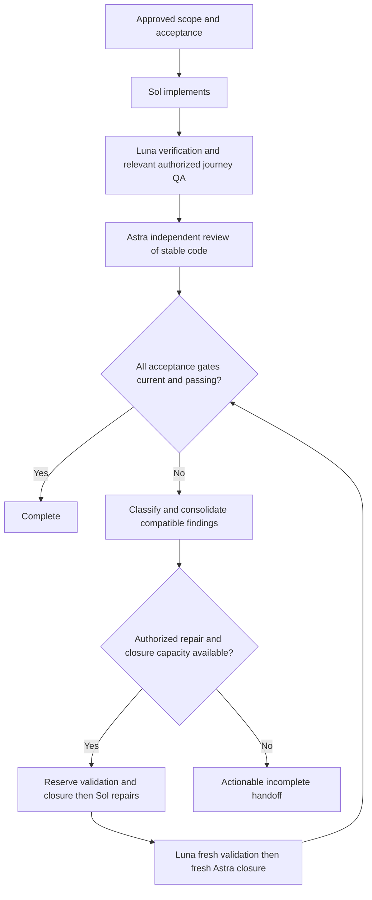

# Development workflow final practical review

**12 October 2026**

The installed workflow has a complete, bounded route to acceptance: Sol 6.1 High implements and repairs, Luna High diagnoses and verifies, and Astra High independently reviews. This final review found three practical recorder issues. The focused correction keeps the same models, approval boundaries and default budgets.

## Corrections

| Observed issue | Corrected behavior |
| --- | --- |
| A passing result allowed completion while a newer check was pending. | Every started check must settle. Pending checks block completion and closure dispatch. An interrupted operation needs its actual recovered result or an evidenced blocked outcome. |
| An older passing result could overwrite a newer failure when parallel results arrived out of order. | Results retain their original check identity. Late results remain in history; evidence from the newer check remains authoritative. Failures still need diagnosis and finding disposition. |
| A failed reviewer launch could use the review capacity needed to close a later repair. | A conclusively unstarted launch can retry with a fresh source-bound token in the existing review allocation. Retries consume bounded attempts and need changed diagnostic evidence. Actual or uncertain execution keeps its charge. |

The launch path is explicit: record a blocked result with `--not-started` and concrete launch proof, record the next bounded `attempt --role review`, then bind the retry with `begin-check --retry-token`. Counters and history remain cumulative. Older consumed tokens cannot be retroactively refunded. Details are in the [checkpoint guide](C:/Users/user/.agents/skills/dev-workflow/references/checkpoints.md).

## Practical lifecycle

The default ceiling is **one initial implementation, one consolidated remediation pass and up to two independent reviews**. Substantial work may explicitly approve **two repairs, three reviews and two relevant journey retests**. Size, resume and a new chat do not grant extra capacity. Required live actions and paid allowances remain separately bounded.

| Scenario | Expected outcome |
| --- | --- |
| Initial checks and independent review pass. | Finish early; no repair or second review. |
| Tests, CI and review find compatible defects. | Classify first, then one meaningful Sol repair covering compatible findings, followed by fresh validation and closure. |
| CI exposes a product, fixture or workflow defect. | Luna diagnoses; Sol owns approved edits. Detection through CI does not change ownership. |
| Environment, access or external service blocks acceptance. | Perform only the authorized prerequisite; finish unaffected work and hand off the unresolved gate. |
| Luna validation fails after the first repair. | Diagnose. An explicitly approved second repair can retain the unused closure reservation and prior check IDs; the default package stops incomplete if its repair ceiling is spent. |
| The last closure review finds another material issue. | Stop incomplete with the defect, proof, used/reserved capacity and smallest next approval needed. |
| Source, dependencies, runtime or project identity changes. | Refresh affected mandatory evidence. The recorder conservatively invalidates whole-source proof; saved runtime labels alone do not establish freshness. |
| A journey needs another live action or paid call. | Confirm its remaining action/cost allowance before repair. A retest reservation does not expand authorization. |
| Review access or model availability fails. | Use the explicit launch retry only with proof that execution never started. Unknown execution remains charged; unavailable independent review remains a closure gap. |

**A failing final Luna test needs a Sol repair when capacity permits, followed by fresh Luna validation and Astra closure. A final Sol edit alone leaves acceptance incomplete. Passing validation needs no extra edit.**

## Validation and limits

The maintained suite now covers 48 tests, including actual temporary fixture edits and separate verification/review processes, interruption, late results, initial and closure launch retries, unknown execution, fresh evidence after repair, distinct journey gates, approved second repair and exhausted budgets. These synthetic actors test recorder behavior; they do not prove live Sol/Luna/Astra routing or real browser/API acceptance.

All **48 maintained tests pass on the installed package**, and the strict setup audit has no errors or warnings. A fresh independent Astra closure review found no material issues, independently passed the same 48 tests, and exercised additional late-result and retry-exhaustion probes.

The recorder records approval and evidence claims. It cannot certify truthful results, enforce arbitrary tool permissions or guarantee provider accounting. Runtime model availability and enforced reviewer isolation require actual runtime evidence. Independent reviewers for this task remain non-mutating under effective workspace-write access.

The correction changes only the recorder, its lifecycle tests and two shared references. Model configuration, application code, live services and automation stay unchanged. The [canonical guide](C:/Users/user/.agents/skills/dev-workflow/references/Codex-Development-Workflow-Guide.md) remains the entry point for regular use.

Original versions of the four changed files are preserved in the [backup manifest](C:/Users/user/.agents/workflow-backups/2026-10-12-final-practical-review/manifest.json).
