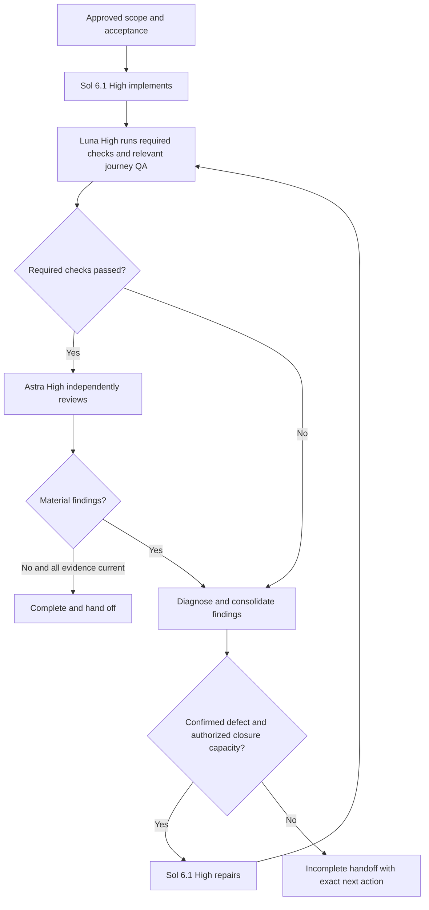

# Development workflow lifecycle review

**12 October 2026 · Current behavior and proposed changes · Setup unchanged**

Initial read-only snapshot. See the [final practical review](dev-workflow-final-review-2026-10-12.md) for the current installed behavior.

The current workflow can complete a development task, and it explicitly forbids claiming success with unresolved mandatory findings. However, its budgets and sequencing can leave a late repair without enough verification or independent review to close the task.

Your concern is valid when Luna finds a defect and the run stops with that fix outstanding. The practical solution is a conditional **Luna finding → Sol 6.1 High repair → fresh testing → independent closure review**. If testing passes, no extra repair is needed. Development should finish with evidence that the final code works.

## Current behavior

| Stage | Installed behavior |
| --- | --- |
| Planning | Investigate, refine and obtain approval before implementation. |
| Implementation | Sol 6.1 High owns implementation and substantive fixes. |
| Testing | Luna High verifies meaningful project gates and reports failures. Small tasks may keep checks in the parent. |
| Independent review | Astra High reviews actual code against approved requirements; a second pass is available for closure. |
| Journey QA | Relevant browser/API acceptance runs within approved action and cost limits. QA stays in the owning browser context if Luna cannot access that exact session. |
| Repair | Consolidate findings, consume a repair round, fix and recheck. Continue autonomously within approved scope and remaining budget. |
| Completion | Every mandatory gate must have current passing evidence, with no unresolved material finding. Otherwise hand off explicit gaps. |

These rules come from the installed [dev-workflow skill](C:/Users/user/.agents/skills/dev-workflow/SKILL.md:14), [verification skill](C:/Users/user/.agents/skills/dev-verify/SKILL.md:8) and [shared policy](C:/Users/user/.agents/skills/dev-workflow/references/workflow-policy.md:19).

**An important exception:** [ci-fix](C:/Users/user/.agents/skills/ci-fix/SKILL.md:8) currently keeps diagnosis and repairs on Luna High, including product-code repairs. A bug discovered in ordinary verification goes to Sol, but the same bug discovered through CI can remain with Luna.

Standalone `$dev-verify` and `$ci-fix` intentionally inspect and report unless repairs are authorized. Inside an approved `$dev-workflow`, the parent owns the continuation through repair and acceptance; a child's report should not become the final stopping point by itself.

## Where closure can fail

| Gap | Practical consequence |
| --- | --- |
| Two reviews but two substantial-task repairs | Initial review → repair 1 → closure review → repair 2 leaves no review allocation for the final code. |
| Closure review can precede the last QA findings | A later defect makes another repair necessary after the reserved review has been consumed. |
| Only one focused browser retest | Two repairs affecting the journey can require two retests, even when repair budget remains. |
| CI has a different repair owner | The route depends on where the defect was detected rather than what needs fixing. |

The [checkpoint recorder](C:/Users/user/.agents/skills/dev-workflow/scripts/run_state.py:246) correctly rejects failed, missing or stale mandatory evidence and unresolved material findings. Source changes also invalidate earlier review evidence. It records results and counters; it does not dispatch repairs or enforce the lifecycle itself.

Therefore, the design supports **honest incomplete handoffs**, rather than automatically satisfying the whole journey. That is appropriate for blocked access, exhausted budgets or missing paid/live authorization. It is avoidable when routine in-scope repairs consume the capacity needed to verify them.

## Proposed flow

Keep the existing models and approval boundaries. Make the repair transition explicit and place the final closure review after the required tests and journey checks on the repaired code.

1. **Test early.** Run meaningful checks during implementation. Gather required journey evidence before review where authorized. Diagnose failing checks before dispatching Astra; review stable code.
2. **Route by cause.** Luna diagnoses failures. Confirmed application and behavioral test defects go to Sol 6.1 High, including defects detected by CI. Luna may retain narrowly assigned CI workflow/tooling repairs.
3. **Consolidate findings.** Use one focused repair round for compatible test, QA and review findings. Preserve failing evidence and add a meaningful regression test when warranted.
4. **Validate each repair.** Luna reruns affected tests and required combined gates. Repeat affected journey acceptance within its existing authorization. Astra then reviews repaired findings and affected paths against the final source.
5. **Continue conditionally.** New confirmed defects return to Sol while approved capacity remains. Scope changes, unavailable access and missing live/paid authorization require a concrete decision.
6. **Finish on acceptance.** No outstanding material defect, no stale mandatory gate, and no edits after final checks without refreshing the required evidence.

For your example, a failing “final Luna test” becomes a repair trigger. Sol fixes it, then Luna tests again and Astra closes the changed code. **Adding a last Sol edit without retesting would still leave the work incomplete.**

## Proposed capacity

Reserve closure capacity before dispatching a repair. Unused allocations stay unused.

| Ceiling | Current small | Proposed small | Current substantial | Proposed substantial |
| --- | --- | --- | --- | --- |
| Repair rounds | 1 | 1 | 2 | 2 |
| Independent reviews | 2 | 2 | 2 | 3 |
| Browser inspection | 1 | 1 | 1 | 1 |
| Focused browser retests | 1 | 1 | 1 | 2 |

Three reviews accommodate an initial pass and a closure pass after each of two repair rounds. Two focused retests accommodate two repairs affecting browser acceptance. This does not increase live request counts or paid allowances; those must separately cover the planned retests. Deterministic test reruns are not the browser-retest counter.

For phased work, allocate and sum capacity before starting. Keep cumulative counters across resume and child skills. Before a repair, confirm that both the repair and its mandatory testing/review can fit the remaining capacity. If they cannot, explain the exact extension needed instead of spending the last round on code that cannot be closed.

No finite budget guarantees completion of every defect. If the last closure pass finds another material issue, report **incomplete** and request a specific extension. Do not quietly defer it or start a new run to reset counters.

**Minimal alternative:** retain two reviews and allow only one repair round. That keeps one review for the repaired code, but is less suitable for substantial work. The proposed two-repair, three-review flow is the better default for substantial tasks.

## Changes to make after approval

| Location | Proposed change |
| --- | --- |
| `dev-workflow/SKILL.md` | Explicit test/QA failure → diagnosis → Sol repair → retest → closure transitions; check remaining closure capacity before edits. |
| `dev-verify` and `ci-fix` | Align ownership of application and behavioral test defects on Sol 6.1 High; preserve Luna diagnosis and narrowly scoped CI tooling work. |
| Policy JSON and policy guide | Allow size-specific review/retest ceilings matching the table above; preserve cumulative limits and approval rules. |
| Checkpoint helper and static audit | Support the size-specific policy shape while preserving freshness and completion checks. |
| Canonical guide and maintained tests | Describe the same sequence; cover late Luna failures, second repairs, stale review evidence and exhaustion. |

Keep the existing recorder and avoid adding a separate workflow engine, hooks or recurring automation. Validate future changes with small synthetic lifecycle scenarios as well as helper tests. OpenAI's [skill evaluation guidance](https://developers.openai.com/blog/eval-skills) recommends checking both the outcome and the actual steps taken; static agreement alone cannot establish that the repair handoff happened.

## Current verification

The installed workflow/helper suite passed **29 tests**. The strict setup audit found one mismatch: the canonical guide says the global parent is **Sol 6.1 xhigh**, while the current configuration is **Sol 6.1 high**. Its delegated route table and budget table matched the policy. Reconcile the guide with the intended setting separately; the closure proposal does not require changing the parent model or effort.

These checks establish installed rules and helper behavior. Actual model routing and effective reviewer isolation remain unproven by the static audit. No development workflow, live application QA or paid evaluation was run for this report. Skills, configuration and application code were left unchanged.
